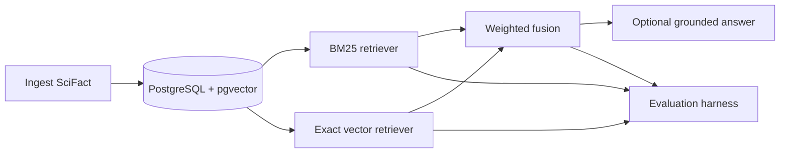

# SciFact Retrieval

Reproducible lexical, vector, and hybrid retrieval with deterministic grounded-answer evaluation on BEIR SciFact.

## Summary

The project ingests SciFact abstracts, queries, qrels, and fixed-size chunks into PostgreSQL with pgvector. It compares BM25 with exact cosine vector retrieval and weighted rank fusion, then evaluates optional evidence-grounded answers from retrieved top-five contexts. On the 300-query test split, frozen hybrid retrieval measured nDCG@10 of 0.7590 (paired 95% interval for hybrid minus vector: [0.0044, 0.0333]). This repository demonstrates a local research workflow, not production deployment, scale, human evaluation, or generalization to other datasets.

## Results

Hybrid parameters were tuned on the train split only (809 queries), followed by one frozen run on the 300 test queries. Bootstrap intervals are paired over queries with 10,000 resamples and seed 20261103.

| Retriever | Recall@10 | Recall@100 | MRR@10 | nDCG@10 |
|---|---:|---:|---:|---:|
| BM25 | 0.7843 | 0.8826 | 0.6302 | 0.6622 |
| Vector, query prefix | 0.8780 | 0.9683 | 0.7016 | 0.7405 |
| Hybrid, alpha 0.7, depth 50 | 0.8963 | 0.9617 | 0.7233 | 0.7590 |

| Paired difference | Mean | 95% interval |
|---|---:|---:|
| Hybrid minus vector, nDCG@10 | 0.0186 | [0.0044, 0.0333] |
| Hybrid minus BM25, nDCG@10 | 0.0968 | [0.0644, 0.1296] |

The generation smoke evaluation used `gemini-2.5-flash-lite`, prompt `answer_v1`, and 5 queries.

| Context | Validity | Grounding | Citation precision | Citation recall | Abstention when relevant absent/present |
|---|---:|---:|---:|---:|---:|
| Hybrid top-5 | 1.0000 | 1.0000 | 1.0000 | 1.0000 | 1.0000 / 0.5000 |
| BM25 top-5 | 1.0000 | 1.0000 | 1.0000 | 1.0000 | 1.0000 / 0.5000 |

## Full generation workflow (Colab, no API)

1. Export the frozen hybrid and BM25 top-5 contexts and prompts: `python .\scripts\generation\export_prompts.py`. This reads the saved rankings and local SciFact snapshots only; it does not rerun retrieval or write to the database. Upload `data/exports/generation_prompts.jsonl` and `data/exports/generation_prompts.meta.json` in [notebooks/colab_generate.ipynb](notebooks/colab_generate.ipynb).
2. In Colab, select a free T4 GPU, run the cells in order, and enter `QWEN_MODEL_ID` when prompted. Recommended: `Qwen/Qwen3-4B` (about 8 GB of fp16 weights, leaving room on a 16 GB T4 for runtime and generation memory); fallback: `Qwen/Qwen3-1.7B` (about 3.4 GB of fp16 weights). These public model repos do not require a Hugging Face token. The notebook disables thinking in the chat template, checks deterministic output, prints three prompt/output examples, then writes resumable 50-prompt segments and downloads `generations.jsonl` plus `generations_meta.json`.
3. Validate without writing, then import idempotently into the test generation cache:
   ```powershell
   python .\scripts\generation\import_generations.py --dry-run
   python .\scripts\generation\import_generations.py
   ```
4. Evaluate only the imported cache (no API calls). Copy the `model_id@revision_hash` value from the metadata and provide it to prevent ambiguity when multiple model runs are cached:
   ```powershell
   python .\scripts\eval\run_generation_eval.py --cache-only --run test --model "Qwen/Qwen3-4B@<revision_hash>"
   ```
   The evaluator writes the existing deterministic metric report and paired hybrid-versus-BM25 bootstrap intervals.

## Architecture



- `backend/app/`: FastAPI API, SQLAlchemy models, BM25, vector retrieval, fusion, and generation.
- `backend/migrations/`: Alembic schema migrations.
- `scripts/ingest/`: rerunnable SciFact ingestion and chunk creation.
- `scripts/embed/`: export, import, embedding, and parity utilities.
- `scripts/eval/`: retrieval, bootstrap, tuning, and generation evaluation.
- `results/`: checked-in evaluation evidence and failure analysis.

## Quickstart

1. Copy `.env.example` to `.env` and set the local database values.
2. Run `docker compose up -d db`.
3. Run `alembic -c backend\alembic.ini upgrade head`.
4. Run `python .\scripts\ingest\ingest_scifact.py`.
5. Import the Colab-produced embeddings as described in [docs/REPRODUCE.md](docs/REPRODUCE.md).
6. Run `python .\scripts\eval\run_eval.py --retriever hybrid --config .\config\hybrid_final.json`.

The full procedure and command verification are in [docs/REPRODUCE.md](docs/REPRODUCE.md).

## Repository layout

```text
backend/       FastAPI service, models, retrieval, and migrations
config/        Frozen hybrid configuration
data/raw/      Local SciFact input files
docs/          Evaluation, decisions, deployment, and reproduction
frontend/      Next.js local search UI
notebooks/     Colab embedding workflow
prompts/       Versioned answer prompt
results/       Evaluation evidence
scripts/       Ingestion, embedding, evaluation, and verification
tests/         Automated tests
```

## Documentation

- [Evaluation report](docs/EVALUATION.md)
- [Decisions](docs/DECISIONS.md)
- [Deployment](docs/DEPLOYMENT.md)
- [Reproduction](docs/REPRODUCE.md)

## Limitations

- The evaluation uses one dataset and a 300-query test split.
- SciFact abstracts are short; 1,005 of 5,183 documents have at least two chunks, so chunking effects are limited here.
- The system is single-node and has no hosted deployment.
- The retrieval intervals are based on one fixed test set; see the full bootstrap table in the evaluation report.
- Generation uses deterministic metrics only and a 5-query smoke evaluation.

## Acknowledgements and licenses

This project uses SciFact from BEIR and `BAAI/bge-base-en-v1.5`. See the original licenses for SciFact, BEIR, and the model. No project license file is currently provided.
