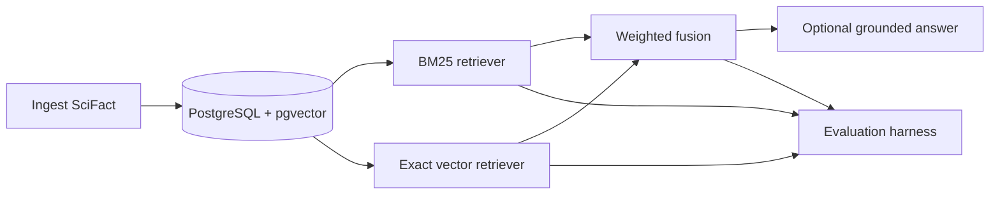

# SciFact Retrieval

Reproducible lexical, vector, and hybrid retrieval with deterministic grounded-answer evaluation on BEIR SciFact.

## Summary

The project ingests SciFact abstracts, queries, qrels, and fixed-size chunks into PostgreSQL with pgvector. It compares BM25 with exact cosine vector retrieval and weighted rank fusion, then evaluates optional evidence-grounded answers from retrieved top-five contexts. On the 300-query test split, frozen hybrid retrieval measured nDCG@10 of 0.7590 (paired 95% interval for hybrid minus vector: [0.0044, 0.0333]). This repository demonstrates a local research workflow, not production deployment, scale, human evaluation, or generalization to other datasets.

## Results

Hybrid parameters were tuned on the train split only (809 queries), followed by one frozen run on the 300 test queries. Bootstrap intervals are paired over queries with 10,000 resamples and seed 20261103.

| Retriever | Recall@10 | Recall@100 | MRR@10 | nDCG@10 |
|---|---:|---:|---:|---:|
| BM25 | 0.7843 | 0.8826 | 0.6302 | 0.6622 |
| Vector, query prefix | 0.8780 | 0.9683 | 0.7016 | 0.7405 |
| Hybrid, alpha 0.7, depth 50 | 0.8963 | 0.9617 | 0.7233 | 0.7590 |

| Paired difference | Mean | 95% interval |
|---|---:|---:|
| Hybrid minus vector, nDCG@10 | 0.0186 | [0.0044, 0.0333] |
| Hybrid minus BM25, nDCG@10 | 0.0968 | [0.0644, 0.1296] |

The full answer evaluation used `Qwen/Qwen3-4B` revision `1cfa9a7208912126459214e8b04321603b3df60c`, prompt `answer_v1`, and 300 test queries per retriever (600 outputs total). One output per retriever failed validation.

| Context | Validity | Grounding | Citation precision | Citation recall | Abstention when relevant absent / present |
|---|---:|---:|---:|---:|---:|
| Hybrid top-5 | 299/300 | 299/300 | 0.6870 (256) | 0.7745 (256) | 0.3265 / 0.1076 |
| BM25 top-5 | 299/300 | 299/300 | 0.6893 (245) | 0.7406 (245) | 0.4474 / 0.0893 |

Citation metrics use only answers containing citations; abstention rates are reported when a relevant document is absent from / present in the top five. See [`results/generation_eval.md`](results/generation_eval.md) for all metrics and examples, and [docs/EVALUATION.md](docs/EVALUATION.md) for interpretation and limitations.

## Reproduce the experiment

The complete fresh-clone procedure covers database setup, importing the included embeddings, train-only hybrid tuning, test retrieval evaluation, and the optional 600-prompt Qwen/Colab evaluation. Follow [docs/REPRODUCE.md](docs/REPRODUCE.md); it also explains which outputs are local and how to interpret the experiment.

## Architecture



- `backend/app/`: FastAPI API, SQLAlchemy models, BM25, vector retrieval, fusion, and generation.
- `backend/migrations/`: Alembic schema migrations.
- `scripts/ingest/`: rerunnable SciFact ingestion and chunk creation.
- `scripts/embed/`: export, import, embedding, and parity utilities.
- `scripts/eval/`: retrieval, bootstrap, tuning, and generation evaluation.
- `results/`: checked-in evaluation evidence and failure analysis.

## Quickstart

Start with [docs/REPRODUCE.md](docs/REPRODUCE.md) for the full setup and experiment steps. The repository includes the embedding arrays; generating new ones in Colab is optional.

## Repository layout

```text
backend/       FastAPI service, models, retrieval, and migrations
config/        Frozen hybrid configuration
data/raw/      Local SciFact input files
docs/          Evaluation, decisions, deployment, and reproduction
frontend/      Next.js local search UI
notebooks/     Colab embedding workflow
prompts/       Versioned answer prompt
results/       Evaluation evidence
scripts/       Ingestion, embedding, evaluation, and verification
tests/         Automated tests
```

## Documentation

- [Evaluation report](docs/EVALUATION.md)
- [Decisions](docs/DECISIONS.md)
- [Deployment](docs/DEPLOYMENT.md)
- [Reproduction](docs/REPRODUCE.md)

## Limitations

- The evaluation uses one dataset and a 300-query test split.
- SciFact abstracts are short; 1,005 of 5,183 documents have at least two chunks, so chunking effects are limited here.
- The system is single-node and has no hosted deployment.
- The retrieval intervals are based on one fixed test set; see the full bootstrap table in the evaluation report.
- Generation uses one Qwen model revision and has no human evaluation or independent verdict-accuracy labels.

## Acknowledgements and licenses

This project uses SciFact from BEIR and `BAAI/bge-base-en-v1.5`. See the original licenses for SciFact, BEIR, and the model. No project license file is currently provided.
